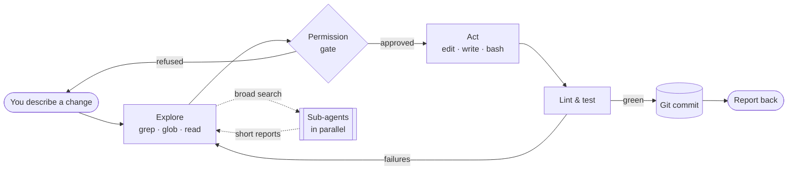
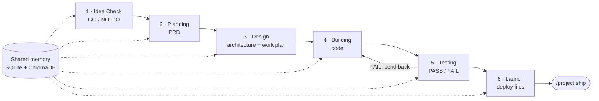
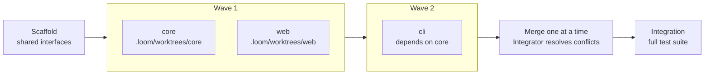
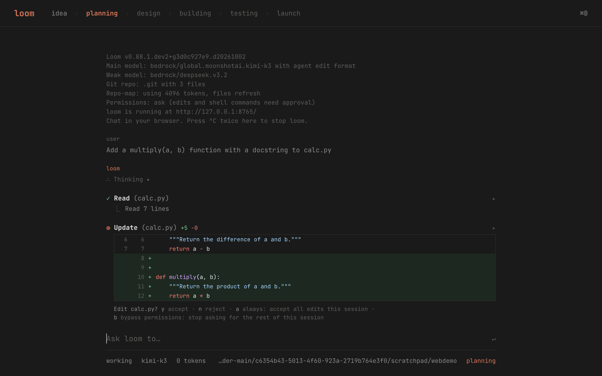

<div align="center">

<pre>
┆┆┆┆┆
━━━━━❯━━━━━
L O O M
</pre>

# Loom

### The AI coding agent that weaves an idea into shipped software — from your terminal or your browser.

<a href="https://github.com/sri-venkat-22/loom">
  
</a>

<p>
  <a href="https://github.com/sri-venkat-22/loom/releases/latest"></a>
  <a href="https://github.com/sri-venkat-22/loom/actions/workflows/ubuntu-tests.yml"></a>
  <a href="https://github.com/sri-venkat-22/loom/actions/workflows/windows-tests.yml"></a>
  <a href="https://github.com/sri-venkat-22/loom/actions/workflows/web-frontend.yml"></a>
  
  <a href="LICENSE.txt"></a>
  <a href="https://github.com/sri-venkat-22/loom/commits/main"></a>
  <a href="https://github.com/sri-venkat-22/loom/stargazers"></a>
</p>

<p>
  <a href="#-quick-start"><b>Quick start</b></a> ·
  <a href="#-features-at-a-glance"><b>Features</b></a> ·
  <a href="#-from-idea-to-launch-project"><b>/project</b></a> ·
  <a href="#-the-web-ui"><b>Web UI</b></a> ·
  <a href="#-models"><b>Models</b></a> ·
  <a href="#-documentation"><b>Docs</b></a> ·
  <a href="#-development"><b>Contributing</b></a>
</p>

</div>

---

Loom is an open-source AI pair programmer that runs inside your git repository. Describe what you want and Loom works as an **agent**: it searches and reads your code, edits files, runs your tests and fixes what breaks — asking before every edit and command, then committing the result to git so `/undo` is always one keystroke away.

When a one-line request isn't enough, **`/project`** takes a raw idea through **six specialised agents** — Idea Check, Planning, Design, Building, Testing and Launch — with an approval checkpoint after each, a shared project memory, test-driven builds, parallel builders on git worktrees and a one-command deploy.

```text
agent> fix the failing test
● Bash(python -m pytest -q)
  ⎿  FAILED tests/test_stats.py::test_mean - assert 2.0 == 2.5
     1 failed, 1 passed in 0.02s
● Read(mathutils/stats.py)
  ⎿  Read 9 lines
● Update(mathutils/stats.py)
Edit mathutils/stats.py? (Y)es/(N)o/(A)lways/(B)ypass [Yes]: y
  ⎿  Updated mathutils/stats.py with 1 addition and 1 removal
● Bash(python -m pytest -q)
  ⎿  2 passed in 0.01s
The mean divided by len(values) + 1; it now divides by len(values) and the tests pass.
```

## ✨ Features at a glance

<table>
<tr>
<td width="50%" valign="top">

### 🤖 A real coding agent
Explores, edits, runs commands and verifies its own work in a loop, calling several tools at once. No need to `/add` files — it finds what it needs.
<br><sub>→ <a href="loom/docs/agent.md">agent.md</a></sub>

</td>
<td width="50%" valign="top">

### 🧵 Six-phase project orchestrator
`/project new <idea>` runs Idea Check → PRD → Architecture → Build → Test → Launch, stopping for your approval between phases.
<br><sub>→ <a href="loom/docs/project.md">project.md</a></sub>

</td>
</tr>
<tr>
<td valign="top">

### 🌌 Parallel sub-agents
The `task` tool hands focused jobs to sub-agents with fresh contexts; several run at once and return only a short report. Define your own agent types in Markdown.
<br><sub>→ <a href="loom/docs/subagents.md">subagents.md</a></sub>

</td>
<td valign="top">

### 🖥️ Terminal *and* browser
`loom --web` opens the same Loom in a local web UI: streaming Markdown, tool cards, inline diffs you accept with `y`, a file tree, Monaco viewer and a project dashboard.
<br><sub>→ <a href="loom/docs/web.md">web.md</a></sub>

</td>
</tr>
<tr>
<td valign="top">

### 🛡️ Permissions you control
Four modes — **ask**, **accept-edits**, **plan** (read-only) and **bypass** — plus allow rules like `bash(pytest*)`. Secrets are hidden from commands; `.git/` and `.loom*` are always protected.
<br><sub>→ <a href="loom/docs/agent.md#permissions">permissions</a></sub>

</td>
<td valign="top">

### ⏪ Checkpoints & rewind
Every request is checkpointed. `/rewind` (or <kbd>Esc</kbd> <kbd>Esc</kbd>) puts the code, the conversation, or both back — shell commands' changes included.
<br><sub>→ <a href="loom/docs/sessions.md#rewind">sessions.md</a></sub>

</td>
</tr>
<tr>
<td valign="top">

### 📋 Plan mode
The agent investigates read-only, then presents a plan — files, steps, risks, how it will verify — for you to approve, edit or send back before a single line changes.
<br><sub>→ <a href="loom/docs/agent.md#plan-mode">plan mode</a></sub>

</td>
<td valign="top">

### 🔌 MCP, hooks & custom commands
Connect any MCP server, run hooks before/after tools to block or format, and save prompts as `/commands` — all in familiar JSON and Markdown formats.
<br><sub>→ <a href="loom/docs/mcp.md">mcp</a> · <a href="loom/docs/hooks.md">hooks</a> · <a href="loom/docs/custom-commands.md">commands</a></sub>

</td>
</tr>
<tr>
<td valign="top">

### 🎨 Google Stitch built in
Set `STITCH_API_KEY` and the agent designs real UI screens with Stitch, then builds them into your code.
<br><sub>→ <a href="loom/docs/mcp.md#google-stitch">Google Stitch</a></sub>

</td>
<td valign="top">

### 🌐 Web search & fetch
`web_search` and `web_fetch` let the agent look up docs, versions and competitors — with per-domain permission rules and cited sources.
<br><sub>→ <a href="loom/docs/agent.md#web-access">web access</a></sub>

</td>
</tr>
<tr>
<td valign="top">

### 💾 Sessions that last
`loom --continue` picks up where you left off — tool calls, files and to-do list included. Long tasks compact themselves instead of overflowing the context window.
<br><sub>→ <a href="loom/docs/sessions.md">sessions.md</a></sub>

</td>
<td valign="top">

### 🗺️ Understands big codebases
A tree-sitter repo map covering 100+ languages, `LOOM.md` project rules on every request, and automatic linting after each edit.
<br><sub>→ <a href="loom/docs/lint-test.md">lint & test</a></sub>

</td>
</tr>
<tr>
<td valign="top">

### 🔀 Git-native
Each change is committed with a sensible message; your own uncommitted work is committed separately first, so `/undo` only takes back the agent's.
<br><sub>→ <a href="loom/docs/git.md">git.md</a></sub>

</td>
<td valign="top">

### 🧠 Any model, cloud or local
Claude, GPT, Gemini, DeepSeek, NVIDIA NIM, Bedrock, Ollama or any OpenAI-compatible server — with reasoning effort, thinking tokens and prompt caching.
<br><sub>→ <a href="loom/docs/models.md">models.md</a></sub>

</td>
</tr>
</table>

## 🚀 Quick start

> [!IMPORTANT]
> Loom installs from GitHub. The `loom` package on PyPI is an **unrelated project** — never run `pip install loom`.

**1. Install** (Python 3.10+ and git)

<details open>
<summary><b>pip</b></summary>

```bash
pip install git+https://github.com/sri-venkat-22/loom.git
```
</details>

<details>
<summary><b>pipx</b> — isolated global command</summary>

```bash
pipx install git+https://github.com/sri-venkat-22/loom.git
```
</details>

<details>
<summary><b>uv</b></summary>

```bash
uv tool install git+https://github.com/sri-venkat-22/loom.git
```
</details>

<details>
<summary><b>A pinned release</b></summary>

```bash
pip install "git+https://github.com/sri-venkat-22/loom.git@v0.88.0"
```

See [all releases](https://github.com/sri-venkat-22/loom/releases). `main` has the newest features described in this README.
</details>

**2. Run it in your project**

```bash
cd /path/to/your/project

loom --model sonnet     --api-key anthropic=<key>   # Anthropic Claude Sonnet
loom --model gpt-4o     --api-key openai=<key>      # OpenAI
loom --model gemini-3.1 --api-key gemini=<key>      # Google Gemini
loom --model deepseek   --api-key deepseek=<key>    # DeepSeek
```

**3. Ask for something**

```text
agent> add a --verbose flag that logs each request, with a test
```

Loom finds the code, shows each edit and command for approval, runs the tests and commits. Type `/undo` to revert, `/help <question>` to ask about Loom, or press <kbd>Shift</kbd>+<kbd>Tab</kbd> to cycle permission modes.

> [!TIP]
> Put standing instructions — coding style, test commands, things to never touch — in a **`LOOM.md`** file at the repo root. They apply to every request.

## 🔁 How the agent works



<details>
<summary><b>🧰 The agent's tools</b></summary>

| Tool | What it does |
|---|---|
| `read_file` | Read a file with line numbers, paged for long files |
| `list_dir` · `glob` · `grep` | Explore the project; git-ignored files are skipped |
| `edit_file` · `write_file` | Exact, unique replacements or whole-file writes |
| `bash` | Run a shell command in the project root (2-min timeout, secrets stripped from the environment) |
| `todo_write` | Keep a visible to-do list for the request |
| `exit_plan_mode` | Present a plan for approval (plan mode only) |
| `web_search` · `web_fetch` | Search the web and read pages as Markdown |
| `task` | Delegate a focused job to a sub-agent |
| MCP tools | Every tool from the MCP servers you connect |

</details>

<details>
<summary><b>🛡️ Permission modes and allow rules</b></summary>

| Mode | Edits | Commands | How to enter |
|---|---|---|---|
| **ask** (default) | ask | ask | `--permission-mode ask` |
| **accept-edits** | auto inside the project | ask | <kbd>Shift</kbd>+<kbd>Tab</kbd> |
| **plan** | refused — read-only, then a plan to approve | refused | <kbd>Shift</kbd>+<kbd>Tab</kbd> or `/plan` |
| **bypass** | auto, everywhere | auto | answer **(B)ypass**, or `/permissions bypass` |

```yaml
# .loom.conf.yml
allow:
  - bash(python -m pytest*)
  - bash(git status)
  - edit(tests/**)
  - web_fetch(domain:docs.python.org)
```

Rules that arrive with a cloned repo (`.loom.permissions.json`, a project `.loom.conf.yml` or `.env`) are never trusted silently — Loom asks once and remembers your answer until they change. For scripts:

```bash
loom --message "fix the failing test" --yes-always --allow "bash(python -m pytest*)"
```

</details>

<details>
<summary><b>🌌 Sub-agents and your own agent types</b></summary>

Built-in types are `explore`, `general` and `plan`. Add your own as Markdown in `.loom/agents/` (per project) or `~/.loom/agents/` (everywhere):

```markdown
---
name: reviewer
description: Reviews a change for bugs and missing tests. Use it after making a change.
tools: Read, Grep, Glob, Bash
model: weak
---
You are a careful code reviewer. Read the diff with `git diff`, then the code around
each change. Report real bugs and missing tests with file:line references.
```

```text
● Task(Map permissions system)
  ⎿  Done (23 tool uses · 241k tokens · 41s)
● Task(Map hooks system)
  ⎿  Done (39 tool uses · 244k tokens · 45s)
```

`/tasks` shows every task's transcript, `/agents` lists the types. Tune with `--max-parallel-tasks`, `--subagent-model`, `--subagent-budget` or turn them off with `--no-subagents`.

</details>

<details>
<summary><b>⏪ Rewind — undo code, conversation, or both</b></summary>

```text
agent> /rewind
Checkpoints, newest first:
  1  10:42  add a test for subtract  · 1 changed, 1 created since
  2  10:31  fix the failing test  · 2 changed, 1 created since
Rewind to before which one? 1
What should go back? (C)ode and conversation/c(O)de only/co(N)versation only/c(A)ncel
```

Checkpoints live in their own git refs, so they never clutter your history, and restores are byte-exact.

</details>

<details>
<summary><b>🪝 Hooks — rules the model can't talk its way around</b></summary>

```json
{
  "hooks": {
    "PreToolUse": [
      { "matcher": "bash", "hooks": [{ "type": "command", "command": "python .loom/check_command.py" }] }
    ],
    "PostToolUse": [
      { "matcher": "edit_file|write_file",
        "hooks": [{ "type": "command", "command": "ruff format \"$LOOM_FILE_PATH\"" }] }
    ]
  }
}
```

Put this in `~/.loom/hooks.json` or `.loom/hooks.json`. A `PreToolUse` hook can block a call (exit code 2) or pre-approve it; project hooks need your approval before they first run.

</details>

<details>
<summary><b>🔌 MCP servers</b></summary>

```json
{
  "mcpServers": {
    "github": {
      "command": "npx",
      "args": ["-y", "@modelcontextprotocol/server-github"],
      "env": { "GITHUB_PERSONAL_ACCESS_TOKEN": "${GITHUB_TOKEN}" }
    },
    "docs": { "type": "http", "url": "https://example.com/mcp" }
  }
}
```

Loom reads `~/.loom/mcp.json`, the project's `.mcp.json` and any `--mcp-config FILE`. Both stdio and streamable-HTTP servers work; `/mcp` shows them and their tools.

</details>

## 🧵 From idea to launch: `/project`

```text
agent> /project new --template fastapi-react A web app where students swap used textbooks
```



Each phase is its own agent with its own prompt, tools and the files it may write — Testing can only write tests, so it reports bugs instead of hiding them; Launch can only write deployment files. After every phase Loom stops at a **checkpoint**: **(A)pprove**, **(E)dit** the document, or **(R)eject** with feedback.

<details>
<summary><b>🧪 Test-driven Building</b> — <code>/project new --tdd</code></summary>

1. The Testing agent turns the PRD's acceptance criteria into tests **before** anything is built. You approve them and they are **locked** (committed and hashed).
2. The Building agent builds, Loom runs the tests, and failures go back to the same agent — up to `--build-retries` times or `--build-budget` dollars.

Edits to locked tests are refused, tampered tests are restored, and new `skip`/`xfail` markers are flagged at the checkpoint.

</details>

<details>
<summary><b>⚡ Parallel builders on git worktrees</b></summary>

The architecture document ends with a YAML work plan of packages, each with the files it `owns`, its tests and dependencies. With more than one package, Building becomes:



Up to `--build-workers` builders (3 by default) work at once, each on its own branch and allowed to write only its own package. An interrupted build resumes with only the packages not merged yet.

</details>

<details>
<summary><b>🚢 Shipping and rollback</b></summary>

| Command | What it does |
|---|---|
| `/project ship` | Deploys to Fly.io with `flyctl`, then smoke-tests `/health` and `/` |
| `/project ship --pr` | Pushes `loom/launch` and opens a GitHub pull request |
| `/project ship --release` | Tags the version and creates a GitHub release |
| `/project rollback` | Redeploys the previous release |

Loom never stores or asks for tokens, runs local checks first, and makes you **type the app's name** before it deploys. It never ships unattended unless you start it with `--allow-deploy`.

</details>

<details>
<summary><b>📦 Templates, shared memory and reports</b></summary>

**Templates** give a known kind of project a head start — decisions, per-phase briefs, a file skeleton, a test command and post-phase checks:

| Template | Stack |
|---|---|
| `python-cli` | argparse, src layout, pyproject.toml, pytest |
| `fastapi-react` | FastAPI API + React/Vite/TypeScript frontend in one container |
| `ml-pipeline` | Config-driven scikit-learn load → features → train → evaluate |

Add your own in `~/.loom/templates/` or `.loom/templates/`.

**Shared memory** keeps every decision and phase document in SQLite with a ChromaDB vector index (falling back to BM25 keyword search with no extra packages). Agents `recall` earlier context and `record_decision`s, so the Launch agent knows what you told the Design agent.

**`/project report docx`** writes the whole journey — timeline, costs, tokens, decisions, every phase document and diff stats — as Markdown, HTML, Word or PDF.

</details>

## 💻 The web UI

<div align="center">

</div>

```bash
loom --web                  # serves http://127.0.0.1:8765/ and opens it
loom --web --port 9000      # another port
loom --web --no-browser     # open the address yourself
```

Same agent, permissions, sessions and `/project` — in your browser. The server only listens on `127.0.0.1` and rejects other origins.

<details>
<summary><b>⌨️ Keyboard shortcuts</b></summary>

| Keys | Action |
|---|---|
| <kbd>⌘</kbd> <kbd>K</kbd> or <kbd>/</kbd> | Command palette |
| <kbd>⌘</kbd> <kbd>B</kbd> | Side pane: changes, files, Monaco viewer, `/run` output, memory, models |
| <kbd>⌘</kbd> <kbd>\\</kbd> | Saved sessions sidebar |
| <kbd>y</kbd> / <kbd>n</kbd> | Accept or reject the pending edit |
| <kbd>Esc</kbd> | Stop the current work |
| <kbd>Shift</kbd> <kbd>Tab</kbd> | Cycle permission modes |

</details>

## 🧠 Models

Loom talks to almost any LLM through LiteLLM and uses up to three at once: a **main** model that writes code, a **weak** model for commit messages and summaries, and an **editor** model for architect mode.

| Provider | Example |
|---|---|
| Anthropic | `loom --model sonnet` |
| OpenAI | `loom --model gpt-4o` |
| Google | `loom --model gemini-3.1` |
| DeepSeek | `loom --model deepseek` |
| NVIDIA NIM | `loom --model nemotron` |
| Ollama | `loom --model ollama_chat/<model>` |
| Any OpenAI-compatible server | `loom --model openai/<model> --openai-api-base http://localhost:8000/v1` |

Keys can come from `--api-key`, the shell, a `.env` file, `~/.loom/credentials.json` or `.loom.conf.yml`. Reasoning models accept `--reasoning-effort` or `--thinking-tokens`. Models without tool calling fall back to classic edit formats automatically. See [models.md](loom/docs/models.md) and [model-aliases.md](loom/docs/model-aliases.md).

## 📟 Command cheat sheet

<details>
<summary><b>The commands you'll use most</b></summary>

| Command | What it does |
|---|---|
| `/plan [request]` | Investigate read-only and present a plan to approve |
| `/project new <idea>` | Start the six-phase orchestrator (`run`, `status`, `approve`, `back`, `ship`, `report`, …) |
| `/rewind [N]` | Put code and/or conversation back to before an earlier request |
| `/undo` | Undo Loom's last commit |
| `/diff` | Show what changed since the last message |
| `/permissions [mode]` | Show rules or switch ask / accept-edits / plan / bypass |
| `/tasks` · `/agents` | Sub-agent transcripts · agent types |
| `/sessions` · `/resume` | List and continue saved conversations |
| `/compact` | Summarize the history to free context |
| `/model` · `/models` | Switch model · search models |
| `/mcp` · `/hooks` | Inspect MCP servers · hooks |
| `/run <cmd>` or `!cmd` | Run a shell command, optionally sharing output |
| `/ask` · `/code` · `/architect` | Classic chat modes |
| `/web <url>` · `/paste` · `/voice` | Add a page, an image, or speak your request |
| `/help <question>` | Ask about Loom itself |

Full list: [commands.md](loom/docs/commands.md) · every CLI flag: [options.md](loom/docs/options.md)

</details>

<details>
<summary><b>More ways to work</b></summary>

- **Watch mode** — write a comment ending in `AI!` in your editor and run `loom --watch-files`; Loom makes the change when you save (or answers `AI?` questions).
- **Images & web pages** — add screenshots, diagrams and docs to the chat for visual context.
- **Voice** — `/voice` records and transcribes your request.
- **Custom commands** — save prompts as Markdown in `.loom/commands/` and run them as `/name args`.
- **Scripting** — `loom --message "…"` runs one request and exits, ideal for CI.

</details>

## 📝 Configuration

Every option can live on the command line, in `.loom.conf.yml` (home or repo root), in `LOOM_*` environment variables or in a `.env` file:

```yaml
# .loom.conf.yml
model: sonnet
permission-mode: accept-edits
allow:
  - bash(npm test*)
```

See [config.md](loom/docs/config.md). Run `loom --help` for every flag.

## 📚 Documentation

| Topic | |
|---|---|
| [Using Loom](loom/docs/usage.md) | Files, chat modes, images, watch mode, voice |
| [The agent](loom/docs/agent.md) | Tools, permissions, plan mode, web access, `LOOM.md` |
| [Sub-agents](loom/docs/subagents.md) | Parallel tasks and your own agent types |
| [Projects](loom/docs/project.md) | The six-phase orchestrator end to end |
| [Web UI](loom/docs/web.md) | `loom --web`, its pane and dashboard |
| [Sessions](loom/docs/sessions.md) | Continue, resume, rewind, compaction |
| [MCP](loom/docs/mcp.md) · [Hooks](loom/docs/hooks.md) · [Custom commands](loom/docs/custom-commands.md) | Extending Loom |
| [Models](loom/docs/models.md) · [Config](loom/docs/config.md) · [Options](loom/docs/options.md) | Setup reference |
| [Git](loom/docs/git.md) · [Lint & test](loom/docs/lint-test.md) | Commits, undo and quality gates |
| [Troubleshooting](loom/docs/troubleshooting.md) | Common problems and reporting bugs |

## 🔧 Development

```bash
git clone https://github.com/sri-venkat-22/loom.git
cd loom
python -m venv .venv && source .venv/bin/activate
pip install -e ".[dev]"
python -m pytest tests/basic
```

<details>
<summary><b>Project layout</b></summary>

```text
loom/
├── coders/          # agent, phase, sub-agent and classic edit-format coders
├── web/             # FastAPI backend + React frontend for --web
├── templates/       # /project templates
├── docs/            # the documentation /help searches
├── orchestrator.py  # six-phase state machine and checkpoints
├── phases.py        # each phase's tools, writable files and verdicts
├── subagents.py     # task tool and agent types
├── permissions.py   # modes, allow rules, protected files
├── checkpoints.py   # /rewind snapshots
├── memory.py        # shared project memory (SQLite + ChromaDB)
├── parallel.py      # parallel builders on git worktrees
└── ship.py          # /project ship and rollback
tests/               # basic, web, browser and help test suites
```

</details>

Contributions are welcome — see [CONTRIBUTING.md](CONTRIBUTING.md). CI runs the test suite on Ubuntu and Windows, pre-commit linting, and a reproducible build check for the web frontend.

## ⭐ Star history

<a href="https://star-history.com/#sri-venkat-22/loom&Date">
  
</a>

## 📄 License

Loom is licensed under the [Apache-2.0 license](LICENSE.txt).

<div align="center">
<sub>If Loom saves you time, a ⭐ helps others find it.</sub>
</div>
